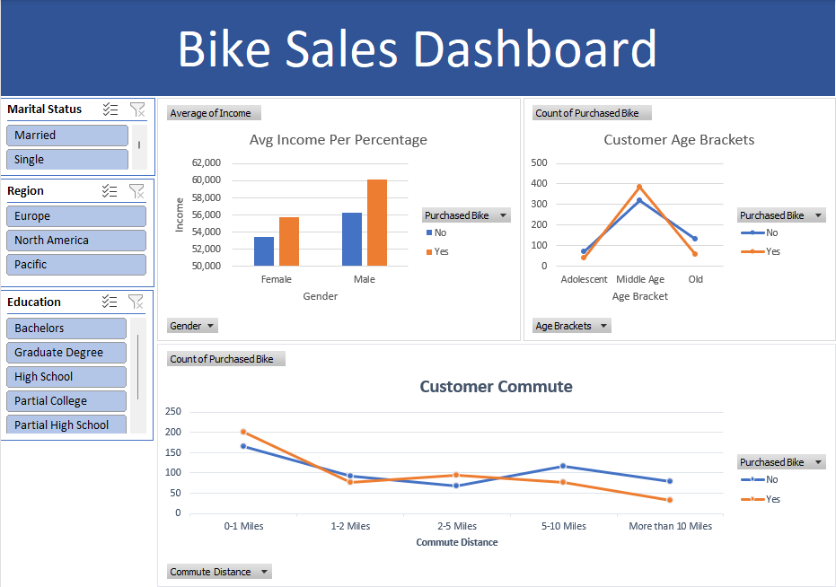

# Bike Buyers Dashboard (Excel)

## Objective
Analyse customer data to understand which factors are linked to buying a bike, including income, age, commute distance, education, marital status and region.

## Dataset
Bike Buyers dataset, provided by Alex the Analyst as part of his data analytics course.

## Approach
Built while following the course walkthrough.
1. Cleaned and organised the raw data using Excel functions
2. Analysed the data with Pivot Tables
3. Created charts for income, age brackets and commute distance
4. Combined them into an interactive dashboard with slicers for marital status, region and education

## Dashboard preview

## Key findings
- Customers who bought a bike have a higher average income than those who did not, for both genders.
- Male customers have a higher average income than female customers.
- Middle-aged customers are the largest group, and they buy more often than they don't.
- Adolescent and older customers are more likely not to buy a bike.
- Customers with a short commute (0-1 miles) buy more often than not, and buying drops as commute distance grows.

## Tools
Microsoft Excel (Pivot Tables, Charts, Slicers)

## Files
- `Bike_Buyers_Excel_Dashboard_Project.xlsx`: Excel workbook with data, pivot tables and dashboard
- `excel_dashboard_preview.png`: dashboard screenshot
